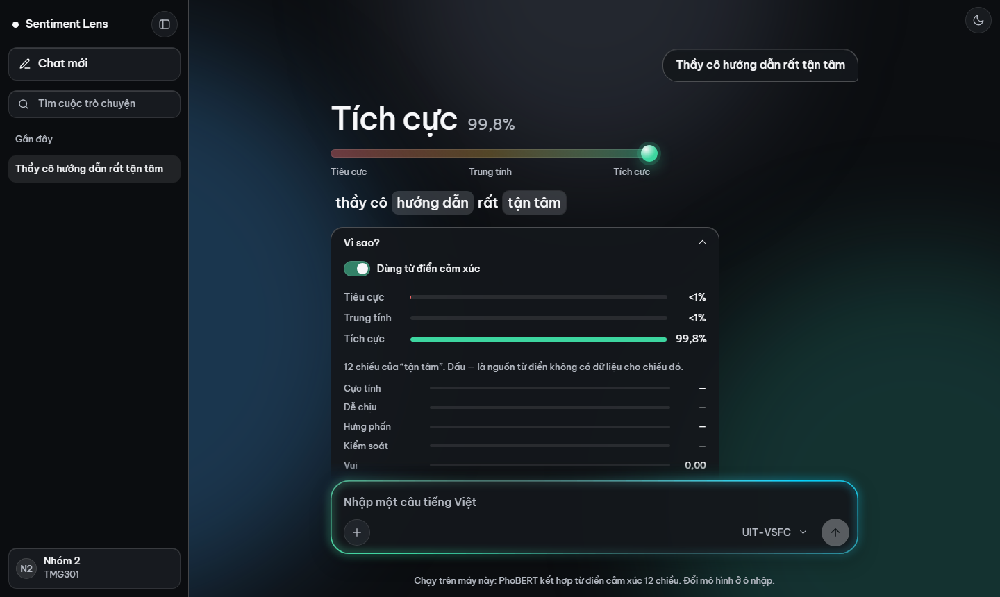

# Demo Report 4: Sentiment Lens

Giao diện web chạy trực tiếp các model nhóm đã train (PhoBERT + từ điển cảm xúc 12 chiều). Gõ một câu tiếng Việt, xem nhãn Tiêu cực / Trung tính / Tích cực, xác suất, và từ nào trong câu có trong từ điển cảm xúc.

## Chạy nhanh (máy đã cài đủ)

1. Nhấp đúp `demo\START_DEMO.bat`.
2. Chờ cửa sổ đen báo `Uvicorn running` (khoảng 10–20 giây để nạp model).
3. Mở Chrome/Edge: `http://127.0.0.1:8000`.

Giữ cửa sổ đen mở trong lúc dùng. Tắt: nhấn Ctrl+C hoặc đóng cửa sổ.

**Cho điện thoại / laptop khác cùng Wi-Fi xem:** nhấp đúp `demo\START_DEMO_LAN.bat`, mở địa chỉ `http://<IP>:8000` mà cửa sổ in ra (IP đổi theo từng mạng). Wi-Fi trường hoặc khách sạn thường chặn các máy kết nối với nhau; khi đó dùng hotspot điện thoại.

## Cài lần đầu

Làm theo mục **Cài đặt trên máy mới** trong [`demo/README.md`](demo/README.md):

- Python 3.12, `torch` theo GPU, rồi `pip install -r demo/requirements-demo.txt`.
- JDK 17+ (VnCoreNLP cần Java), đặt `JAVA_HOME`.
- Tải từ Drive của nhóm vào đúng chỗ: `artifacts/checkpoints/`, `artifacts/hf-cache/phobert-base/`, `artifacts/tools/vncorenlp/`, `data/lexicons/composite_12d/v0.2.0/`. Hai thư mục `artifacts/` và `data/` không nằm trong git (giấy phép dữ liệu chỉ cho nghiên cứu, checkpoint mỗi file ~545 MB).

Thiếu file nào, script báo rõ tên file đó.

## Dùng giao diện

- **Chọn model** ở ô nhập:
  - Khuyên dùng: `UIT-VSFC` (phản hồi sinh viên), `VLSP2016` (bình luận sản phẩm công nghệ), `AIVIVN 2019` (chỉ 2 nhãn).
  - Đối chiếu: `UIT-VSFC (bản 2)`, `VLSP2016 (lần chạy 1)`.
- Chọn model đúng miền với câu. Model UIT chạy trên câu bình luận sản phẩm sẽ kém hơn rõ rệt.
- Bấm một **câu mẫu** hoặc gõ câu của mình, Enter để gửi.
- Bấm **Vì sao?** để xem xác suất từng nhãn. Bấm một từ trong câu để xem 12 chiều từ điển của từ đó (dấu — là nguồn từ điển không có dữ liệu).
- Công tắc **Dùng từ điển cảm xúc**: tắt nhánh từ điển lúc suy luận trên chính model đó. Đây **không phải** model đối chứng train riêng (baseline A).
- Lần đầu chọn một model mất 2–3 giây để nạp; các câu sau khoảng 10–30 ms.

## Lưu ý khi trình bày

- Câu nhập được chuẩn hóa và tách từ giống lúc train. Không xử lý teencode ("k", "đc"), vì lúc train nhóm không dùng bảng teencode.
- Số liệu chính thức của các model nằm trong `artifacts/reports/*.json` và [`demo/README.md`](demo/README.md) (mục Mô hình).
- Lỗi thường gặp và cách xử lý: [`demo/README.md`](demo/README.md) (mục Chạy).

## Cấu trúc

| Đường dẫn | Nội dung |
|---|---|
| `demo/web/index.html` | Giao diện (một file HTML/CSS/JS, không cần build) |
| `demo/api/` | API FastAPI: nạp checkpoint, tiền xử lý, trả kết quả và số liệu theo từng từ |
| `demo/tests/` | Test với model thật (`python -m pytest demo/tests -q`, cần `JAVA_HOME`) |
| `demo/run_api.ps1` | Script khởi động (dùng bởi các file `.bat`) |
| `demo/README.md` | Cài đặt chi tiết, hợp đồng API, số đo hiệu năng |
